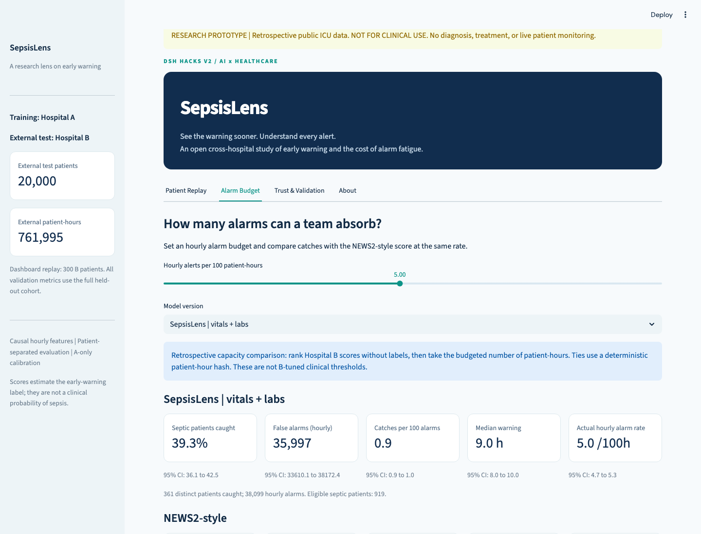
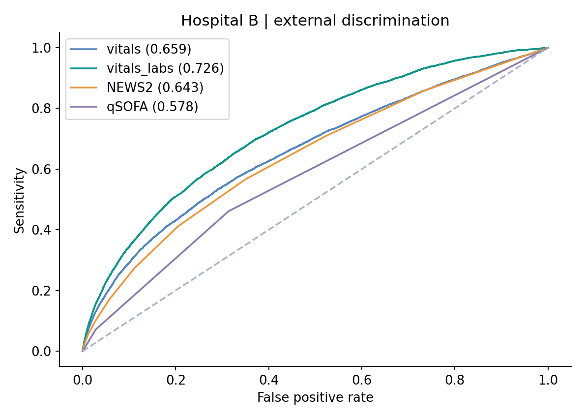
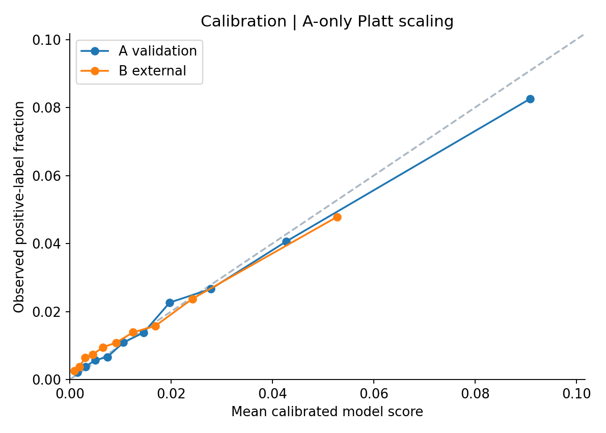
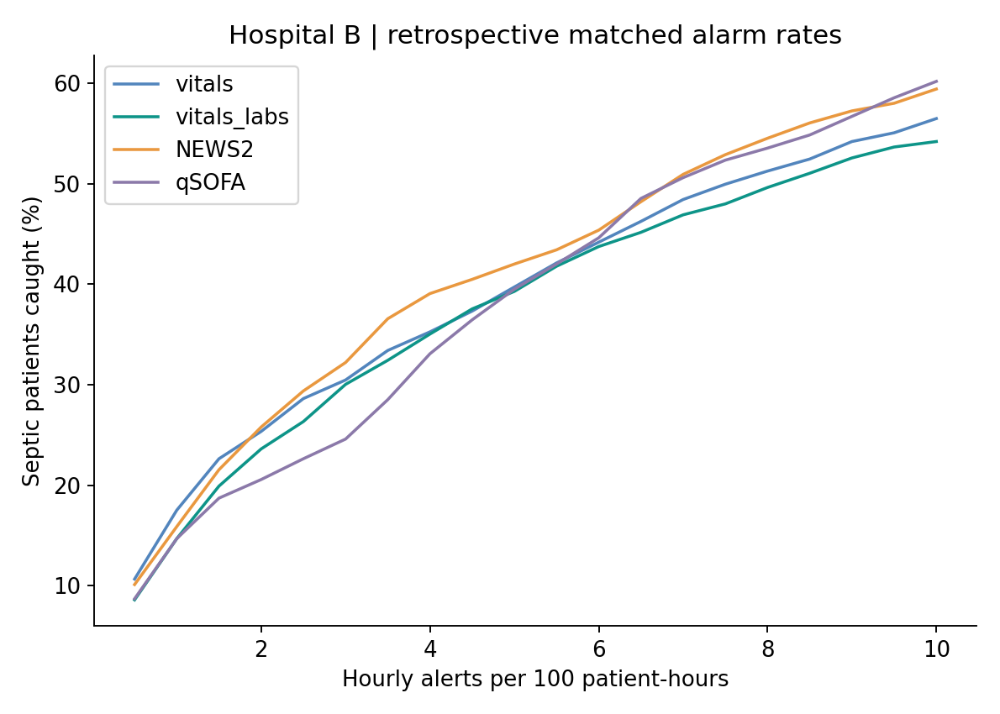

# SepsisLens
**An open, explainable cross-hospital sepsis early-warning research prototype. DSH Hacks V2 | AI x Healthcare.**

> **NOT FOR CLINICAL USE.** Retrospective public ICU data only. Do not use for diagnosis, triage, treatment, or live monitoring.

## Why
CDC estimates about 1,700,000 US adults develop sepsis yearly; at least 350,000 die during hospitalization or go to hospice.
At the studied threshold, Epic's model missed 67% of sepsis cases in external validation. This is context, not a head-to-head comparison.
In the observational TREWS study, provider confirmation within three hours was associated with a 18.7% adjusted relative mortality reduction. This does not establish that alerts caused the reduction.

## Approach
Hospital A trains two class-weighted LightGBM models: vitals and vitals + labs. A patient-level split reserves validation; a separate slice of training patients calibrates probabilities using Platt scaling. Light tuning and operational thresholds use A validation only. Hospital B remains external test data.
Causal features: patient-wise forward fill, lab measurement flags, rolling six-hour means/minima/maxima/slopes, hourly changes, shock index, Age and Gender. Slopes use actual hourly positions and no future values. ICULOS, HospAdmTime, identifiers, hospital and unit are excluded from model inputs.

## Real results from this run
External B: **20,000 patients**, **761,995 hours**, **1,142 septic patients**.
A validation: **4,068 patients**.
Numbers below are generated from reports/metrics.json. Operational thresholds are selected on A for a conservative five hourly alerts per hundred hours and locked on B.

| Method | B AUROC (95% CI) | B AUPRC (95% CI) | Official utility | Caught % | Warning h |
|---|---|---|---|---|---|
| vitals | 0.659 (0.644-0.674) | 0.035 (0.032-0.039) | 0.076 | 31.0 | 7.0 |
| vitals_labs | 0.726 (0.713-0.738) | 0.045 (0.040-0.051) | 0.058 | 17.0 | 7.5 |
| NEWS2 | 0.643 (0.630-0.656) | 0.027 (0.025-0.030) | 0.044 | 30.5 | 8.0 |
| qSOFA | 0.578 (0.568-0.589) | 0.018 (0.017-0.020) | 0.014 | 23.7 | 8.0 |

| Method | Budget /100h | Caught % | Catches /100 alarms | Nonbeneficial hourly alarms | Median warning h |
|---|---|---|---|---|---|
| vitals_labs | 1.0 | 14.7 | 1.77 | 7017 | 7.0 |
| vitals_labs | 2.0 | 23.6 | 1.42 | 14180 | 8.0 |
| vitals_labs | 5.0 | 39.3 | 0.95 | 35997 | 9.0 |
| vitals_labs | 10.0 | 54.2 | 0.65 | 72807 | 11.0 |
| NEWS2 | 1.0 | 15.9 | 1.92 | 7215 | 7.0 |
| NEWS2 | 2.0 | 25.8 | 1.56 | 14529 | 8.0 |
| NEWS2 | 5.0 | 42.0 | 1.01 | 36641 | 9.0 |
| NEWS2 | 10.0 | 59.4 | 0.72 | 73682 | 10.0 |

The budget table is a retrospective matched-capacity comparison using label-free ranking within B, with deterministic hash tie-breaking. It is not an operational B-tuned threshold.
See reports/metrics.json for A-versus-B metrics, confidence intervals, subgroup audits, actual alert rates, thresholds and definitions.

## Run the included demo
Requires Python 3.12 (see .python-version). Full data is unnecessary for the app.

    cd sepsislens
    python3.12 -m venv .venv
    source .venv/bin/activate
    python -m pip install -r requirements.txt
    streamlit run app/app.py

On the configured Mac, the environment already exists:

    cd "/Users/monishannabheemoju/Desktop/Hackathons/DSH Hacks V2/sepsislens"
    .venv/bin/streamlit run app/app.py

macOS LightGBM requires OpenMP: brew install libomp. Linux: install libgomp1. The Mac has libomp installed.

## Reproduce all results in one command

    bash run_all.sh

Use Python 3.12. With uv installed, the script creates that interpreter automatically. Otherwise create a Python 3.12 venv first.
The downloader uses the same public S3 prefix as:

    aws s3 sync --no-sign-request s3://physionet-open/challenge-2019/1.0.0/training/ data/raw/

If AWS CLI is unavailable, Python downloads the same objects through unsigned S3 HTTPS, falling back to the PhysioNet HTTPS file index. Downloads resume and retry. No synthetic data or partial-cohort shortcuts.
A complete run downloads all recordings, loads parquet, creates features, trains, evaluates with 500 whole-patient bootstrap resamples, builds plots/demo, regenerates docs, and runs protocol tests.

## Dashboard
- **Patient Replay:** patient selector and hourly slider; vitals, model/NEWS2 lines, A-locked threshold, alert and inferred onset markers; top 35 SHAP factors and templated explanations.
- **Alarm Budget:** full-cohort model versus NEWS2 at matched hourly capacity, catches, nonbeneficial alarms, catches per hundred alarms and warning time with confidence intervals.
- **Trust & Validation:** A versus B, official utility, confidence intervals, calibration, subgroup audit and limitations.
- **About:** cited context, pipeline and baseline approximations.
The app never retrains. It reads a shipped bundle of 300 B patients, cached SHAP, model artifacts and full-cohort metrics.

## Deploy
**Streamlit Community Cloud:** push this directory as the repository root, including demo/, models/, reports/, vendor/, src/, app/, requirements.txt and .streamlit/. Choose app/app.py as the entry point and Python 3.12. packages.txt supplies Linux OpenMP. Do not upload data/ or .venv/.
If nested in a repository, adjust the entry point accordingly and ensure dependency files are discovered.

**Hugging Face Spaces:** create a Docker Space and push this directory as its root. Dockerfile serves Streamlit on port 8501; README metadata sets app_port. No dataset download or training occurs during build or startup. scripts/verify_bundle.py verifies that serving artifacts are under 100 MB.
Cloud publication requires your GitHub or Hugging Face account/repository connection. A local run does not claim cloud publication.

## Evaluation contract
- **Thresholds**: Conservative 5 hourly alerts/100 hours on A validation; unchanged on B.
- **Budget**: Retrospective label-free within-cohort score ranking, SHA256 patient-hour tie-break; not a prospectively deployable threshold or tuning on B outcomes.
- **Catch**: At least one hourly alert in [inferred onset-12h, inferred onset); first-label-positive patients excluded because onset is left-censored.
- **False Alarm**: An hourly alert outside the useful pre-onset window, including repeated late/post-onset alerts.
- **Catches Per 100 Alarms**: Distinct caught patients / all hourly alerts x100; not hourly PPV.
- **Warning**: Median onset minus first useful alarm, conditional on a catch.
- **Onset**: First positive SepsisLabel hour + 6; inferred, not independently observed. First-hour positives are left-censored.
- **Ci**: 500 percentile bootstrap replicates resampling whole patients, fixed model/threshold/ranking; excludes model-training and threshold-selection uncertainty.
- **Auprc**: Average precision (step-function PR area).
- **Calibration**: Platt scaling fitted on held-out A training patients; not refitted on B.

## Limitations
Retrospective research cannot demonstrate improved patient outcomes. Missingness and test-ordering may encode local workflow; lab measurement flags can shift across hospitals. Forward-fill never uses the future, but observations can become stale. A validation participates in model selection, so its performance is optimistic. Bootstrap intervals hold the model and operating rule fixed and omit training uncertainty. Binary recorded sex and broad age groups are incomplete fairness audits.
Onset is inferred, not independently observed. First-hour-positive recordings have left-censored onset and are excluded from onset-based catch/warning denominators, but retained in hourly AUROC/AUPRC and utility. Some inferred onsets fall outside the recording. Alerts count every positive hour with no cooldown; this is an explicit workload proxy, not a validated nursing workflow. False alarms mean alarms outside the evaluable pre-onset window, including left-censored or undefined onset; they are not clinically adjudicated false positives.
qSOFA-style omits mental status. NEWS2-style uses oxygen-saturation scale 1 and omits consciousness, supplemental oxygen and scale-2 eligibility. Missing components contribute zero, potentially understating severity. These approximations are not validated clinical NEWS2/qSOFA. Official utility is threshold-dependent and distinct from the custom pre-onset catch metric.
The default replay is a deliberately selected illustrative case. The rest of the demo is randomly sampled. Demo replays are not used to estimate external performance.

## Layout
src/: loading, features, baselines, training, evaluation and explanations. app/app.py: dashboard. data/: git-ignored. models/: both models, feature lists and patient split manifest. reports/: metrics, plots and screenshots. demo/: replay predictions, features and cached SHAP. vendor/: official scorer.

## Checks

    .venv/bin/python -m pytest -q
    .venv/bin/python scripts/smoke_app.py
    .venv/bin/python scripts/verify_bundle.py

Optional visual verification: install Playwright Chromium, launch Streamlit, then run scripts/browser_check.py. Results are saved to reports/verification.json and reports/browser_verification.json.

## Sources and attribution
Data: Reyna MA et al. Early Prediction of Sepsis From Clinical Data: The PhysioNet/Computing in Cardiology Challenge 2019. Critical Care Medicine. 2020;48(2):210-217. DOI: [10.1097/CCM.0000000000004145](https://doi.org/10.1097/CCM.0000000000004145). [Dataset v1.0.0](https://physionet.org/content/challenge-2019/1.0.0/), CC BY 4.0. Demo patient values and derived recordings retain this attribution/license.
Official scoring source and BSD license: [physionetchallenges/evaluation-2019](https://github.com/physionetchallenges/evaluation-2019), vendored without changes in vendor/official.py.
[CDC sepsis burden](https://www.cdc.gov/sepsis/about/), [Wong et al. 2021](https://jamanetwork.com/journals/jamainternalmedicine/fullarticle/2781307), [Adams et al. / TREWS 2022](https://www.nature.com/articles/s41591-022-01894-0).

