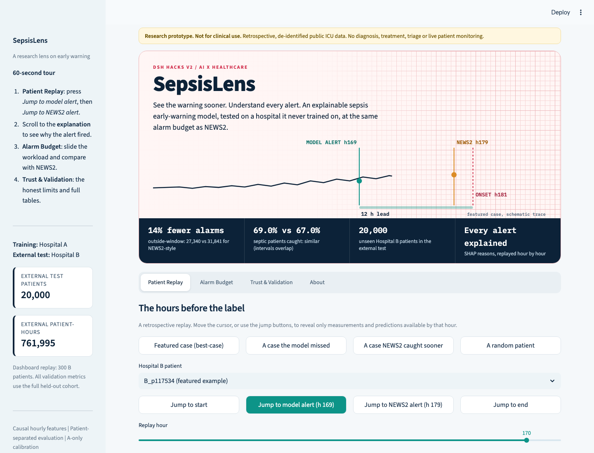
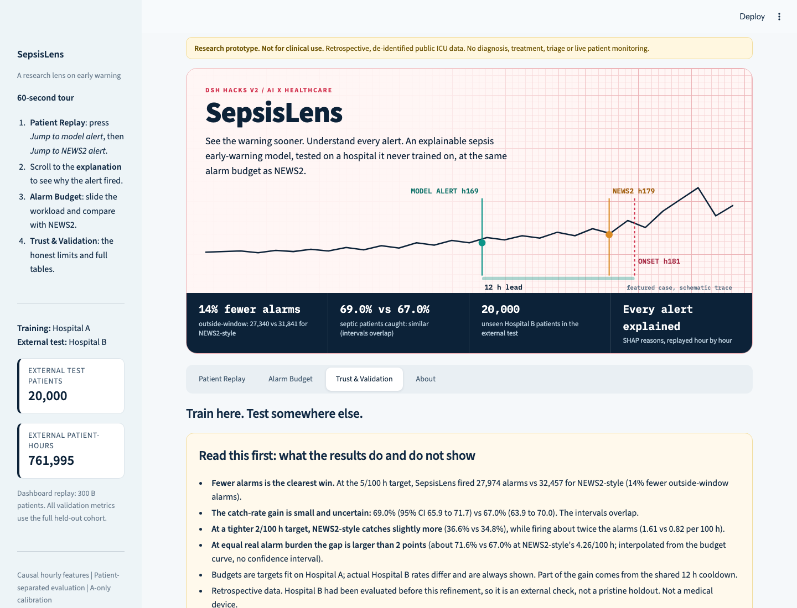

# SepsisLens
**Explainable sepsis early-warning research | DSH Hacks V2 | AI x Healthcare**

> **Research prototype, NOT FOR CLINICAL USE.** Retrospective public ICU recordings. No diagnosis, treatment, triage or live patient monitoring.

## Headline (Hospital B, never used for training)
At a nominal budget of 5 alerts per 100 patient-hours with a 12-hour cooldown, SepsisLens caught **69.0%** of eligible septic patients (634/919) versus **67.0%** for a NEWS2-style score (616/919), with **14.1% fewer outside-window alarms** (27,340 vs 31,841). Median warning: 7 h vs 6 h. Hourly AUROC 0.726 vs 0.643.
**Honest limits of that claim:**
- The 5-per-100h figure is the *target* thresholds were fit to on Hospital A. Realized Hospital B rates were 3.67 (model) and 4.26 (NEWS2) alerts per 100 patient-hours, so the model also fired fewer alarms.
- The catch-rate gap is small: 95% patient-bootstrap intervals overlap (65.9-71.7% vs 63.9-70.0%); a separate paired bootstrap on the saved predictions gave a +2.0 pp difference with a 95% interval of about -1.6 to +5.6 pp, so we do not claim a statistically significant catch gain. The clearer advantage is fewer alarms per catch.
- **At a 2-per-100h budget NEWS2 catches slightly more** (36.6% vs 34.8%), but its realized rate is about twice as high (1.61 vs 0.82 per 100 h). At 10 per 100 h both methods tie (92.9%).
- **At equal realized alarm burden the gap is larger** (read from the budget curves by linear interpolation, point estimates without intervals): 71.6% (model) vs 67.0% (NEWS2) at NEWS2's 4.26 alerts per 100 h.
- Part of the improvement comes from the shared alert cooldown policy, not only the model.
- The default replay patient was chosen to illustrate an early alert; it is not representative. In the 300-patient replay sample (25 evaluable septic patients) the model alerts in the warning window for 19 and NEWS2-style for 16; where both alert the model is earlier in 5 cases and NEWS2-style in 8. The app lets you open a missed case.
- Hospital B had been evaluated before this refinement, so it is an external check, not a pristine holdout.

## Key results
Full Hospital B evaluation: 20,000 patients, 761,995 hours.
A-only selected candidate: **original**; shared alert cooldown: **12 hours**.
The original model is retained if no candidate improves A-selection catches at every target budget. Stronger hourly AUROC does not guarantee better patient catches.

| Version | Method | AUROC | AUPRC | Official utility | Caught at 2 (%) | At 5 (%) | At 10 (%) |
|---|---|---|---|---|---|---|---|
| Before: legacy B ranking | vitals_labs | 0.726 | 0.0448 | 0.0583 | 23.6 | 39.3 | 54.2 |
| Before: legacy B ranking | NEWS2 | 0.643 | 0.0271 | 0.0436 | 25.8 | 42.0 | 59.4 |
| Before: legacy B ranking | qSOFA | 0.578 | 0.0182 | 0.0142 | 20.6 | 39.5 | 60.2 |
| After: A-locked, shared cooldown | refined | 0.726 | 0.0448 | -0.0130 | 34.8 | 69.0 | 92.9 |
| After: A-locked, shared cooldown | NEWS2 | 0.643 | 0.0271 | -0.0268 | 36.6 | 67.0 | 92.9 |
| After: A-locked, shared cooldown | qSOFA | 0.578 | 0.0182 | -0.0349 | 26.2 | 54.4 | 92.9 |

**Historical-protocol caveat:** legacy before figures use retrospective B ranking with no cooldown. After figures use A-only thresholds with cooldown. They are different operating protocols; catch gains are not evidence of better discrimination or a matched B alarm rate.

For a consistent A-only threshold methodology, the same run also computes the original model and baselines without suppression:
| Version | Method | AUROC | AUPRC | Official utility | Caught at 2 (%) | At 5 (%) | At 10 (%) |
|---|---|---|---|---|---|---|---|
| Before: A-locked, no cooldown | vitals_labs | 0.726 | 0.0448 | 0.0540 | 6.5 | 15.6 | 29.9 |
| Before: A-locked, no cooldown | NEWS2 | 0.643 | 0.0271 | 0.0488 | 21.2 | 38.5 | 54.0 |
| Before: A-locked, no cooldown | qSOFA | 0.578 | 0.0182 | 0.0110 | 16.8 | 27.9 | 52.6 |
| After: A-locked, shared cooldown | refined | 0.726 | 0.0448 | -0.0130 | 34.8 | 69.0 | 92.9 |
| After: A-locked, shared cooldown | NEWS2 | 0.643 | 0.0271 | -0.0268 | 36.6 | 67.0 | 92.9 |
| After: A-locked, shared cooldown | qSOFA | 0.578 | 0.0182 | -0.0349 | 26.2 | 54.4 | 92.9 |

| Method | A target | Actual B alarms/100h | Caught (%) | Catches/100 alarms | Median warning h |
|---|---|---|---|---|---|
| refined | 2 | 0.82 | 34.8 | 5.12 | 5.0 |
| refined | 5 | 3.67 | 69.0 | 2.27 | 7.0 |
| refined | 10 | 8.88 | 92.9 | 1.26 | 7.0 |
| NEWS2 | 2 | 1.61 | 36.6 | 2.74 | 6.0 |
| NEWS2 | 5 | 4.26 | 67.0 | 1.90 | 6.0 |
| NEWS2 | 10 | 8.88 | 92.9 | 1.26 | 7.0 |
| qSOFA | 2 | 1.44 | 26.2 | 2.19 | 6.0 |
| qSOFA | 5 | 4.31 | 54.4 | 1.52 | 6.0 |
| qSOFA | 10 | 8.88 | 92.9 | 1.26 | 7.0 |

AUROC/AUPRC use original challenge hourly labels before suppression. Utility uses emitted alerts under each operating rule. All values are generated from reports/metrics.json. The report contains 500 patient-bootstrap intervals, all cooldowns, subgroup results and A-versus-B metrics.

## What changed and what did not help
Trials covered six-to-twelve-hour early labels, pre-onset labels with post-onset rows dropped, equal-patient weighting, longer vital/lab windows, NEWS2 changes, LightGBM settings, and logistic NEWS2/risk-trend stacking.
Stackers fit on 1,627 A-validation patients; model/policy comparison uses 2,441 different A-validation patients. Existing tree fits use A training patients; early stopping/calibration stay in A.
Cooldown is chosen using the original model's A-selection catch average. Candidates can replace it only if they do not regress at any of the target budgets and improve the mean. Full A validation then supplies final thresholds. A model SHA and policy lock are recorded before B is accessed.
| Candidate | A caught at 2 (%) | At 5 (%) | At 10 (%) | Retained |
|---|---|---|---|---|
| original | 56.5 | 81.3 | 93.8 | yes |
| early6_12 | 25.9 | 74.6 | 93.8 | no |
| early6_12_long | 23.3 | 77.7 | 93.8 | no |
| early6_12_smooth | 18.1 | 76.2 | 93.8 | no |
| preonset12_long | 52.8 | 79.3 | 93.8 | no |
| preonset12_flexible | 52.8 | 80.8 | 93.8 | no |
| hourly_long | 45.6 | 79.3 | 93.8 | no |
| original_stack | 53.4 | 83.4 | 93.8 | no |
| early6_12_long_stack | 42.0 | 76.7 | 93.8 | no |
| preonset12_long_stack | 50.3 | 81.9 | 93.8 | no |
| hourly_long_stack | 44.6 | 81.3 | 93.8 | no |

Unselected model binaries are excluded from the serving bundle. Full experiment parameters and outcomes remain in reports/experiments_A.json.

## Problem and cited context
CDC estimates about 1,700,000 US adults develop sepsis yearly, with at least 350,000 hospital deaths or hospice discharges. [CDC](https://www.cdc.gov/sepsis/about/)
Wong et al. reported 67% of cases missed by Epic's model at the studied threshold. This is not a head-to-head comparison. [JAMA Internal Medicine](https://jamanetwork.com/journals/jamainternalmedicine/fullarticle/2781307)
TREWS provider confirmation within three hours was associated with a 18.7% adjusted relative mortality reduction in an observational study; no causal mortality claim is made here. [Nature Medicine](https://www.nature.com/articles/s41591-022-01894-0)

## Run the app
Python 3.11 is verified for deployment; the existing Mac environment also runs Python 3.12.
The app reads the demo bundle and metrics only. It never retrains or reads data/raw at startup.

    cd sepsislens
    .venv/bin/streamlit run app/app.py --server.address=0.0.0.0

Clean setup:

    python3.11 -m venv .venv
    source .venv/bin/activate
    python -m pip install -r requirements.txt   # app only; use requirements-dev.txt for tests/pipeline
    streamlit run app/app.py

macOS requires OpenMP: brew install libomp. Linux packages.txt installs libgomp1.

## Reproduce the pipeline
Full rebuild, including A-only experiments and the locked external evaluation:

    bash run_all.sh

Resume with verified existing original features and the completed A policy lock; a matching completed external report is reused without another B pass:

    bash run_all.sh --resume

The downloader resumes the public PhysioNet S3 files, with HTTPS fallback. Patient splits, seeds, candidate results, selected policy and model hashes are saved. Re-running the full pipeline repeats the external check; it does not create an additional untouched test cohort.
To rerun only the A-development stage:

    .venv/bin/python -m src.refine

## Onset and alert definitions
**Inferred onset = first SepsisLabel=1 recording hour + 6.** Challenge labels were shifted six hours early. This is not independently observed clinical onset. First-hour-positive recordings are left-censored; do not infer an exact warning time for them.
Every feature uses current/past information only. ICULOS, HospAdmTime, recording hour, patient/hospital identity and unit indicators are excluded from predictors.
- **Thresholds**: For each target budget and cooldown, fit a label-free threshold grid on A validation only; apply the saved rule unchanged to B. Actual B alert rates may differ. No B quantiles or B threshold search.
- **Budget**: Budget slider specifies an A-validation capacity target, not an exact external B alarm rate. Actual B rates are shown; compare methods using both catches and actual burden.
- **Cooldown**: An alert at hour t suppresses the next N hours for that patient. Earliest repeat is t+N+1. Same selected N applies to every method. No future data is used.
- **Catch**: At least one emitted alert in [inferred onset-12h, inferred onset); first-hour-positive cases excluded from onset metrics.
- **False Alarm**: An emitted alert outside the evaluable useful pre-onset window, including undefined/left-censored onset. Research workload proxy, not clinically adjudicated false positives.
- **Catches Per 100 Alarms**: Distinct caught patients / all emitted alarms x100.
- **Warning**: Median onset minus first useful emitted alert, conditional on a catch.
- **Onset**: First SepsisLabel=1 recording hour + 6. Labels were shifted six hours early. Inferred, not independently observed; first-hour-positive cases are left-censored.
- **Ci**: 500 percentile bootstrap resamples of whole patients; frozen model, A-thresholds and causal cooldown sequences. Excludes model-selection/training uncertainty.
- **Utility**: Unmodified official PhysioNet 2019 normalized utility applied to emitted sparse alerts; this score penalizes suppressed hourly positives and is not optimized for episodic alert workflows.
- **Auprc**: Average precision against the original hourly challenge labels, even for models trained on pre-onset targets.
- **Calibration**: Base models use A-only Platt scaling for their training target. A stacked policy score is not a calibrated probability of the challenge label; reliability plots audit that mismatch.

## Dashboard and screenshots
Patient Replay has causal vitals/model/NEWS2 plots, emitted-alert markers, inferred onset, a replay slider, explicit lead time, and cached model explanations. Alarm Budget shows A-target capacity, actual B burden and adjustable shared cooldown. Trust & Validation starts with key results and before/after tables. About cites the data and studies.

## Deploy to Streamlit Community Cloud
Clean Python 3.11 and demo-only execution: passed. Docker build/run: untested; Docker unavailable on the Mac. No account creation or remote push.

1. Use this sepsislens directory as the repository root. Include app/, src/, demo/, models/, reports/, vendor/, requirements.txt, packages.txt and .streamlit/. Exclude data/, environments and logs. requirements.txt holds only the runtime packages the app imports (training and test tools are in requirements-dev.txt).
2. In your own GitHub account, create/select a repository and push the prepared project yourself. No push or account creation is performed by this task.
3. Open Streamlit Community Cloud, choose Create app, select that repository and branch, and set the main file path to app/app.py.
4. Under Advanced settings, select Python 3.11. No secrets or dataset download are required.
5. Deploy and verify the four tabs. The app loads the shipped demo bundle; requirements.txt is pinned and packages.txt supplies Linux OpenMP.
If nested in a repository, set the entry point and dependency discovery paths accordingly; using this folder as the root is recommended.

## Hugging Face / Docker
Create a Docker Space yourself and upload this directory. Dockerfile serves port 8501 and README metadata sets app_port. No training occurs during image build or startup.

    docker build -t sepsislens .
    docker run --rm -p 8501:8501 sepsislens

Docker status is stated above; configuration is not claimed verified when Docker is absent.

## Checks

    .venv/bin/python -m pytest -q
    .venv/bin/python scripts/smoke_app.py
    .venv/bin/python scripts/verify_bundle.py
    .venv/bin/python scripts/browser_check.py

Browser checks require Playwright Chromium and a running app. Deployment-isolation checks use scripts/check_deployment.py. Results and screenshots live in reports/.

## Limitations
This is retrospective methodological research, not evidence of clinical benefit. **Not for clinical use.** Missingness/test ordering and carried-forward measurements can reflect local workflow. First-hour-positive recordings have left-censored onset: they remain in hourly discrimination/utility but are excluded from onset-based catches and warning-time denominators. Some inferred onsets fall beyond the recording.
The original B evaluation has already been seen. This refinement is A-only development followed by another external check on the same B cohort, not a new untouched confirmatory study. Do not claim B is a pristine final holdout for future iterations. No B threshold quantiles or B model selection are used in this run.
A validation is used for development, so its performance is optimistic. Stacker fitting uses a separate patient slice from candidate assessment. Bootstrap intervals freeze the selected model, thresholds and alert sequences; they omit training/selection uncertainty.
Cooldown lowers repeated burden but also limits maximum attainable alarm rate. A target may be unattainable; B rates can drift in either direction. Read actual B rates beside catches. The official hourly utility penalizes suppressed positive hours and is not an episodic-alert utility. It is reported without changing the reference scoring logic.
Outside-window alarms are not adjudicated clinical false positives. They include records with undefined/left-censored onset. NEWS2-style omits consciousness, supplemental oxygen and scale-2 eligibility; qSOFA-style omits mental status. Missing components contribute zero. These partial scores are not validated clinical NEWS2/qSOFA.
Binary recorded sex and age bands are incomplete fairness audits. The default replay is automatically chosen to illustrate an early model alert; it is deliberately selected, not representative performance evidence.

## Data and attribution
Dataset: Reyna MA et al. Early Prediction of Sepsis From Clinical Data: The PhysioNet/Computing in Cardiology Challenge 2019. Critical Care Medicine. 2020;48(2):210-217. [DOI](https://doi.org/10.1097/CCM.0000000000004145). [PhysioNet v1.0.0](https://physionet.org/content/challenge-2019/1.0.0/), CC BY 4.0. Demo patient values/derived records retain this attribution.
The unmodified [official PhysioNet 2019 evaluator](https://github.com/physionetchallenges/evaluation-2019) is in vendor/official.py with its BSD license. Project code uses MIT; data licensing remains separate.

